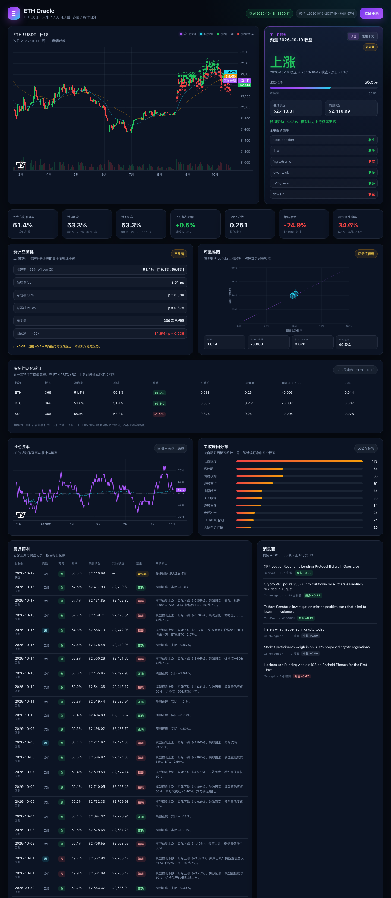

# ETH Oracle

ETH 次日与未来 7 天方向预测 · 多因子统计研究工具。用 Binance 现货/合约、宏观、链上、资金费率和新闻情绪构造特征，预测 ETH/USDT 下一个 UTC 日线收盘以及 7 天后的方向，并在本地网页中展示真实 K 线、预测价格路径、历史命中/失败标记、滚动胜率、统计显著性、概率校准和多标的泛化验证。日模型每日更新；周模型只有在回测门禁通过时才输出，当前因显著跑输基线已暂停。



> **研究用途，不构成投资建议。** 加密资产波动极大，任何模型都无法稳定预测次日方向。本项目诚实地展示回测结果，包括低于 50% 的年份和负收益的策略诊断。

## 当前实测结果

首轮 365 天走步回测区间为 `2025-10-18 → 2026-10-18`，共 366 个已结算预测：

| 指标 | 数值 |
|---|---:|
| 方向准确率 | **51.4%**（188 / 366） |
| 基线（多数类） | 50.8% |
| 相对基线超额 | +0.5% |
| 准确率 95% Wilson CI | [46.3%, 56.4%] |
| 标准误 | 2.61 pp |
| 二项检验 vs 50% | **p = 0.638** |
| 二项检验 vs 基线 | p = 0.875 |
| Brier 分数 | 0.2508 |
| Brier skill vs 常数 0.5 | -0.003 |
| ECE / 概率 Sharpness | 0.0136 / 0.0203 |
| AUC | 0.5088 |
| 多空日频策略累计 | -24.9% |

**结论：不能认为模型优于随机。** 51.4% 与 50% 的差异在 366 个样本下完全可能是噪声（p=0.638）；概率输出集中在 0.48–0.53，Brier skill 略为负值，说明模型几乎没有区分度。项目的第一目标是**可复现、可审计、不过度承诺**，而不是制造一个“高胜率”黑箱。

## 多标的泛化验证

同一套 154 个特征与训练流程（替换目标资产的价格/资金费率，保留共享宏观与 BTC 上下文），分别对 ETH、BTC、SOL 做 365 天样本外走步回测：

| 标的 | 样本 | 准确率 | 基线 | 超额 | p（vs 50%） | Brier | Brier skill | ECE |
|---|---:|---:|---:|---:|---:|---:|---:|---:|
| ETH | 366 | 51.4% | 50.8% | +0.5% | 0.638 | 0.2508 | -0.003 | 0.014 |
| BTC | 366 | 51.6% | 51.4% | +0.3% | 0.565 | 0.2506 | -0.002 | 0.007 |
| SOL | 366 | 50.6% | 52.2% | -1.6% | 0.875 | 0.2511 | -0.004 | 0.026 |

三个标的都没有统计显著的超额，SOL 甚至低于“永远猜多数类”的基线。这进一步说明 ETH 上的 +0.5% 更像过拟合噪声，而不是可迁移的规律。

## 模型上线门禁与每日复盘

每次每日任务不会无条件覆盖线上模型：

- 用当前数据训练一个**挑战者**，同时在最近 60 天（目标已揭晓）上评估在任模型和“门禁挑战者”（训练截止日提前 60 天，避免直接看过评估窗口）。
- 只有挑战者准确率高于在任模型（容忍 0.5pp 噪声），或准确率持平且 Brier 更好，并且 Brier 恶化不超过 0.02、准确率不低于自身基线 2pp 时，才替换 `model_latest.joblib`。
- 未通过时保留在任模型，挑战者另存为 `data/models/model_challenger.joblib`，决策、双方指标和原因写入日报“每日复盘与模型门禁”章节。
- 门禁是**相对比较**，不是收益保证；在任模型可能训练时见过评估窗口，因此评估对挑战者偏保守。

**周模型门禁**：当周回测样本 ≥30 且（准确率低于基线 2pp 以上，或 p<0.05 且准确率低于 50%）时，暂停生成周 live 预测，并清除未结算的周预测；回测继续增量更新，样本/表现恢复后才重新输出。当前周回测 `n=52, acc=34.6%, baseline=51.9%, p=0.036`，已触发暂停。

首轮门禁实测（2026-10-20）：在任 `v20261019-203749` acc 56.7% / Brier 0.2364，挑战者 acc 55.0% / Brier 0.2488，决策**保留在任模型**；周模型同日暂停输出。

首轮 7 天预测回测（52 个不重叠窗口）结果更差：**34.6%**，基线 51.9%，二项检验 **p = 0.036（显著低于随机）**，Brier 0.2778，ECE 0.209。当前周模型不可用于交易，只保留为研究和对照；这也说明“加长周期”并不能自动提升方向预测能力。复现命令：

```bash
.venv/bin/python -m app.validate_assets --symbols ETHUSDT,BTCUSDT,SOLUSDT --days 365
```

## 预测对象

- 交易对：`ETH/USDT`（Binance 现货日线，UTC 00:00 收盘）。
- 输入：截至 `as_of` 日收盘的全部信息。
- 次日目标：`as_of` 收盘 → 下一日收盘的涨跌方向，以及下一日收盘价估计。
- 周目标：`as_of` 收盘 → 7 天后收盘的涨跌方向，以及 7 天后收盘价估计；仅在周模型通过门禁时输出。
- 网页中的紫色/青色虚线分别连接次日与周预测；历史回测的正确/错误用绿色/红色标记。周模型暂停时，周标签页显示“未通过验证”和原因。
- 预测在目标日收盘后自动结算；下次运行时会写入实际收盘价、方向是否正确、失败原因标签，并重新训练。
- 每日任务会生成日预测、运行模型门禁，并增量补齐日/周回测（每 7 天一个周目标日，每 30 天重训）。

## 模型与流程

1. **数据拉取**：Binance K 线/资金费率、FRED 宏观、DefiLlama TVL/稳定币、Alternative.me 恐惧贪婪指数、Wikipedia 关注度、RSS 新闻。
2. **特征工程**（约 154 个特征）：动量、波动率、ATR、均线、RSI/MACD/布林/ADX/MFI、量价、BTC/ETH-BTC/黄金联动、美股/美元/美债/VIX/信用利差、资金费率、恐惧贪婪、TVL/稳定币、新闻情绪、日历和交互项。
3. **集成模型**：HistGradientBoosting + RandomForest + ExtraTrees + LogisticRegression；分类器输出上涨概率，HGB 回归器输出预测涨跌幅。
4. **校准与动态权重**：按最近验证集做 Platt 校准；每日用近 90 天各子模型的方向表现调整集成权重（下限 8%，防止单模型归零）。
5. **走步回测**：默认 365 天，初始训练至少 420 天，每 30 天重训一次，严格只用 `as_of` 之前的数据；日/周模型分别训练，周模型训练截止日额外前移 7 天，避免目标泄漏。
6. **每日优化与门禁**：结算待定预测 → 重训挑战者 → 在近 60 天对比在任模型 → 通过才部署，否则保留冠军 → 更新权重/阈值 → 生成日预测；周模型通过回测门禁时才输出 → 写入 SQLite、Markdown 日报和复盘章节。
7. **统计诊断**：Wilson 置信区间、精确二项检验（对 50% 与多数类基线）、Brier / Brier skill、ECE / MCE、可靠性图分箱、概率 sharpness；同时评估跨标的泛化。
8. **失败归因**：低置信度、高波动、情绪极端、逆势、BTC 联动、宏观冲击、消息面冲击、大幅单边行情等；同一笔错误可命中多个标签。

## 数据源与降级

| 来源 | 用途 | 状态/说明 |
|---|---|---|
| Binance Spot | ETH/BTC/ETHBTC/PAXG 日线 | 必需；带本地 CSV 增量缓存 |
| Binance Futures | 资金费率、标记价格 | 可选；失败时用缓存/空列 |
| FRED | 美债 10Y、美元指数、标普、纳指、VIX、高收益债利差、期限利差 | 可选；FRED 对部分 User-Agent 会挂起，代码使用 `curl` UA + 直连优先 |
| Alternative.me | 恐惧贪婪指数 | 可选；失败时用缓存 |
| DefiLlama | ETH TVL、稳定币供应 | 可选；失败时用缓存 |
| Wikipedia Pageviews | ETH 关注度 | 可选；失败时用缓存 |
| RSS | CoinDesk / Cointelegraph / Decrypt / CryptoSlate | 实时新闻情绪；单源失败不影响整体 |
| GDELT | 历史新闻 tone | 默认关闭；共享 IP 常被 429，设置 `ETORACLE_ENABLE_GDELT=1` 才启用 |

所有可选源失败都会写入 `data/cache/last_refresh.json`，网页顶部会显示“源降级”提示；不会因为单个源失败而中断。

## 快速开始

要求：macOS/Linux、Python 3.11+（本项目在 Python 3.12.13 上验证）。

```bash
cd /path/to/eth-oracle

python3.12 -m venv .venv
.venv/bin/python -m pip install -r requirements-dev.txt

# 首次运行：拉全量数据 + 365 天走步回测（约 4 分钟，视网络而定）
.venv/bin/python -m app.daily --backtest-days 365

# 多标的泛化验证（可选，约 3–4 分钟/标的）
.venv/bin/python -m app.validate_assets --days 365

# 启动网页
.venv/bin/python -m uvicorn app.main:app --host 127.0.0.1 --port 8787
open http://127.0.0.1:8787
```

之后每日只需：

```bash
.venv/bin/python -m app.daily
```

`--no-fetch` 可以跳过外部数据刷新，直接用 `data/cache/dataset.csv` 重训，适合调试特征/模型。

## 每日自动运行（macOS launchd）

```bash
# 安装 server + 每日 08:10（本地时间，UTC+8）任务
bash scripts/install_launchd.sh

# 查看状态
launchctl print gui/$(id -u)/ai.m1.eth-oracle
launchctl print gui/$(id -u)/ai.m1.eth-oracle-daily

# 卸载
bash scripts/uninstall_launchd.sh
```

- 网页服务：`http://127.0.0.1:8787`
- 每日任务日志：`logs/daily.launchd.out.log`、`logs/daily.launchd.err.log`
- 手动运行也写入 `logs/daily-YYYY-MM-DD.log`
- 08:10 是 Binance UTC 日线收盘（08:00）后的 10 分钟；此时目标日线已确定，可结算上一日预测。

## API

| 方法 | 路径 | 说明 |
|---|---|---|
| GET | `/api/health` | 健康检查、数据行数、预测计数 |
| GET | `/api/overview` | 首屏聚合数据（含日/周最新预测、周模型门禁） |
| GET | `/api/candles?days=240` | K 线、EMA、日/周预测线、历史正确/错误标记 |
| GET | `/api/predictions?mode=all&limit=80&horizon=all` | 预测记录（horizon: all/1/7） |
| GET | `/api/metrics` | 总体/实盘/回测/周指标、周门禁、显著性、校准、滚动准确率、失败分布 |
| GET | `/api/validation` | 多标的泛化验证结果（需先运行 validate_assets） |
| GET | `/api/failures?limit=100` | 失败预测和归因分布 |
| GET | `/api/news?limit=50` | 新闻与情绪汇总 |
| GET | `/api/report` | 最新 Markdown 日报 |
| GET | `/api/model` | 最新模型信息与特征重要性 |
| POST | `/api/run` | 后台启动一次完整每日流程 |
| GET | `/api/job/{job_id}` | 查询后台任务状态 |

## 目录结构

```text
eth-oracle/
├── app/
│   ├── config.py              # 路径、端口、代理、回测参数
│   ├── data/
│   │   ├── http.py            # 代理优先/直连回退 HTTP
│   │   ├── market.py          # Binance K 线/资金费率
│   │   ├── macro.py           # FRED
│   │   ├── sentiment.py       # F&G、新闻、Wikipedia、GDELT
│   │   ├── onchain.py         # DefiLlama
│   │   └── build.py           # 合并数据、缓存、刷新状态
│   ├── features.py            # 154 个特征与目标
│   ├── model.py               # 集成、校准、训练、预测（日/周）
│   ├── evaluation.py          # 指标、二项检验、校准、滚动胜率、权重、阈值
│   ├── analysis.py            # 失败归因、Markdown 日报
│   ├── db.py                  # SQLite（按 horizon 隔离预测）
│   ├── daily.py               # 每日流程（日/周预测与回测）
│   ├── promotion.py           # champion/challenger 门禁、周模型输出门禁
│   ├── validate_assets.py     # ETH/BTC/SOL 多标的走步验证
│   ├── main.py                # FastAPI + 静态页
│   └── static/                # 前端（原生 HTML/CSS/JS + Lightweight Charts）
├── scripts/                   # 启动、每日任务、launchd
├── tests/                     # pytest（合成数据，不依赖网络）
├── docs/
│   ├── PLAN.md                # 设计、进度、已知问题、路线图
│   └── screenshot.png
├── data/                      # 运行数据（gitignore）
├── reports/                   # 每日 Markdown（gitignore）
└── logs/                      # 运行日志（gitignore）
```

## 环境变量

| 变量 | 默认值 | 说明 |
|---|---|---|
| `ETORACLE_DATA_DIR` | `./data` | 数据目录 |
| `ETORACLE_DB` | `data/eth_oracle.db` | SQLite 路径 |
| `ETORACLE_REPORT_DIR` | `./reports` | 日报目录 |
| `ETORACLE_PROXY` | `http://127.0.0.1:10900` | 外呼代理；置空可关闭代理 |
| `ETORACLE_HOST` / `ETORACLE_PORT` | `127.0.0.1` / `8787` | 网页监听 |
| `ETORACLE_BACKTEST_DAYS` | `365` | 默认回测天数 |
| `ETORACLE_MIN_TRAIN_ROWS` | `420` | 初始训练最少行数 |
| `ETORACLE_RETRAIN_DAYS` | `30` | 走步回测重训间隔 |
| `ETORACLE_WEEKLY_BACKTEST_DAYS` | `365` | 周回测天数（周周期固定为 7 天） |
| `ETORACLE_PROMOTION_EVAL_DAYS` | `60` | champion/challenger 对比窗口天数 |
| `ETORACLE_PROMOTION_MIN_N` | `30` | 门禁最少对比样本 |
| `ETORACLE_PROMOTION_ACC_TOLERANCE` | `0.005` | 准确率视为持平的容差 |
| `ETORACLE_PROMOTION_BRIER_TOLERANCE` | `0.02` | 允许的 Brier 最大恶化 |
| `ETORACLE_WEEKLY_MIN_EVAL_N` | `30` | 周模型门禁最少回测样本 |
| `ETORACLE_WEEKLY_MAX_UNDERPERFORMANCE` | `0.02` | 周准确率允许低于基线的最大幅度 |
| `ETORACLE_ENABLE_GDELT` | `0` | 是否启用 GDELT 历史新闻 tone |

## 测试与检查

```bash
.venv/bin/python -m pytest
node --check app/static/app.js
```

44 个测试使用合成行情和临时数据库，不访问网络；覆盖特征（含 7 日目标）、模型训练/保存（含周模型）、二项检验、校准曲线、归因、日报、SQLite（含 horizon 迁移与 pending-only 清理）、promotion 门禁（含周模型失效判断）和 API。

## 已知限制与后续方向

- 次日方向接近随机：51.4% 的准确率对 50% 的二项检验 p=0.638，95% CI 横跨随机水平；BTC/SOL 同样不显著，不能据此实盘。
- 概率输出几乎不偏离 0.5（sharpness≈0.02，Brier skill 为负），可靠性图虽然接近对角线，但模型并没有真实区分能力。
- 首轮 7 天回测仅 52 个样本，准确率 34.6%（p=0.036，显著低于随机）；周模型当前是失败的研究分支，系统已自动暂停周 live 输出，不应作为交易信号。
- champion/challenger 门禁只比较近 60 天相对表现，样本少、噪声大；在任模型训练时可能见过该窗口，因此门禁对挑战者偏保守，不能保证上线模型更好。
- 门禁解决的是“别让新模型无条件覆盖旧模型”，不是“找到有 edge 的模型”；日模型仍可能与随机无法区分。
- 回测未完整计入手续费、滑点、资金费率和买卖价差；策略曲线是诊断指标，不是可交易净值。
- FRED 对 User-Agent 敏感，代码固定使用 `curl` UA；若未来再次挂起，可考虑切换到 stooq/Yahoo 或本地宏观缓存。
- GDELT 默认关闭；历史新闻 tone 缺失时，历史情绪主要由恐惧贪婪指数代表，实时新闻情绪只进入当日预测和复盘。
- 新闻情绪使用 VADER 英文词典，对中文/反讽/标题党有限；后续可换金融情绪模型或 LLM 打分。
- 模型只做日线方向；未建模盘中路径、波动率期限结构、期权 skew、ETF  flows、链上转账等。
- 后续可加入：概率校准的滚动验证、特征漂移监控、按波动率分层的子模型、交易成本后的净值、更多链上数据、自动化模型选择。

## 升级记录

### 2026-10-20

- 新增 champion/challenger 上线门禁（`app/promotion.py`）：每日训练挑战者，在最近 60 天与在任模型对比；准确率不劣化、Brier 恶化在容忍范围内才替换线上模型，否则保留冠军并另存挑战者。
- 新增周模型输出门禁：周回测样本 ≥30 且准确率低于基线 2pp 以上或显著低于随机时，自动暂停周 live 预测并清理未结算周记录；当前已触发暂停（`n=52, acc=34.6%, baseline=51.9%, p=0.036`）。
- 日报新增“每日复盘与模型门禁”：记录在任/挑战者准确率、Brier、版本、上线/保留决策、周模型门禁状态、近 30 次准确率和主要失败原因。
- `/api/overview` 与 `/api/metrics` 增加周模型门禁状态；周标签页在暂停时显示“周模型已暂停 / 未通过验证”及原因。
- `clear_predictions` 支持 `pending_only`，避免清理周信号时删除已结算历史。
- 新增 10 个门禁/清理测试，总计 44 个测试通过。
- 首轮真实门禁结果：在任 `v20261019-203749`（acc 56.7%, Brier 0.2364）对比挑战者（acc 55.0%, Brier 0.2488），保留在任模型；周模型暂停输出。
- 说明：门禁是保守的相对比较，不是收益保证；它只防止新模型无条件覆盖旧模型。

## License / 声明

本项目为个人研究代码，未提供任何收益承诺。使用本项目产生的任何交易决策及后果由使用者自行承担。
